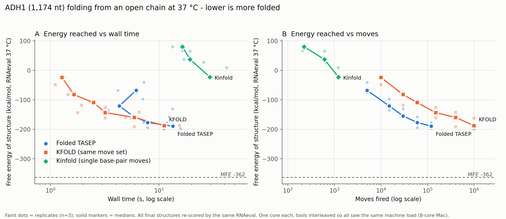
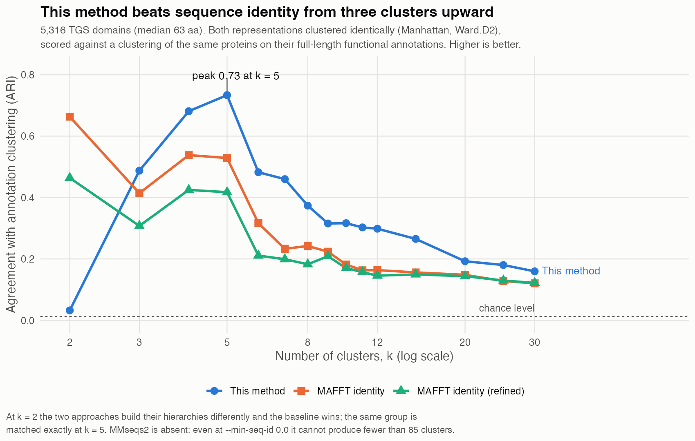
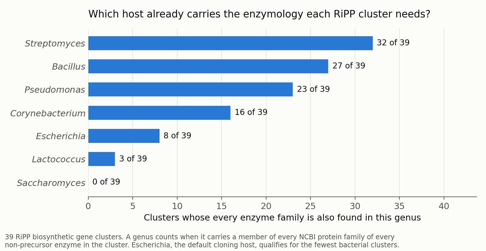

# Computational Biology Portfolio

Three independent projects developed during my PhD at the University of Illinois Urbana-Champaign:
a stochastic simulator in C++, an original sequence-clustering method, and a practical tool for a
wet-lab problem. Each has been validated against measured data or against the standard alternative,
and each README states where the method fails as well as where it works.

> **Source code is not included.** This work was developed using University resources and is subject
> to the University's intellectual property rules, so the code and, for two projects, the methods
> themselves are withheld. What is here is what each project achieves and how that was established —
> enough to judge the work without it. Details are available privately on request.

---

## Folded TASEP — translation on a folding mRNA

A Gillespie simulator in which mRNA secondary structure is not fixed: it folds and unfolds helix by
helix while ribosomes, scanning complexes and helicases move along it and pull it apart. ~190 KB of
C++20 over the ViennaRNA energy model, 29 literature-derived reactions.

Benchmarked against the published folding simulators KFOLD and Kinfold on the same transcript, with
every final structure re-scored by the same energy function:

**Reaches the same folding depth as KFOLD in roughly 8x fewer moves**, at comparable wall time, and
far ahead of Kinfold. Performance came from optimizations measured with confidence intervals and
verified against an exact oracle — one worth 14-78x — and two of the five tried turned out not to
work at all, which that project's figure shows alongside the ones that did.

[Read more →](folded-tasep-simulator/)

---

## Alignment-free protein clustering

An original method for grouping protein sequences without building a multiple sequence alignment —
because over divergent sequences the alignment is the weak link. MAFFT spread these 63 aa domains
across 634 columns, ten times their own length in gaps, and refining it made the result worse.

On 5,316 proteins it recovers the **full-length protein family from a 63 aa domain alone**
(ARI 0.73 at 5 clusters, p = 0.001 against a selection-aware null), beating alignment-derived
identity at 14 of 15 resolutions and scaling at n^1.33 against the n^1.96 of dynamic-programming
alignment.

[Read more →](alignment-free-clustering/)

---

## Heterologous expression host selection

Heterologous expression fails often, and late. This picks a host up front by asking, for every enzyme
in a biosynthetic gene cluster, whether the candidate host's genus already carries proteins from the
same families.

Across 39 RiPP clusters, *Escherichia* — the default cloning host — qualified for only 8, while
*Streptomyces* qualified for 32. That ordering matches what natural-product labs find at the bench,
and it is produced from sequence data before any cloning is done.

[Read more →](expression-host-selection/)

---

## Author

Sam Belsky · sbelsky2@illinois.edu · [LinkedIn](https://linkedin.com/in/sam-belsky-7433a5190)
