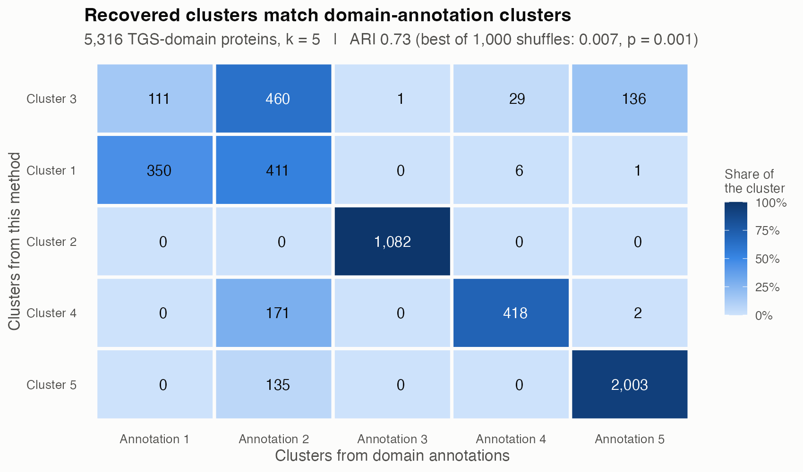
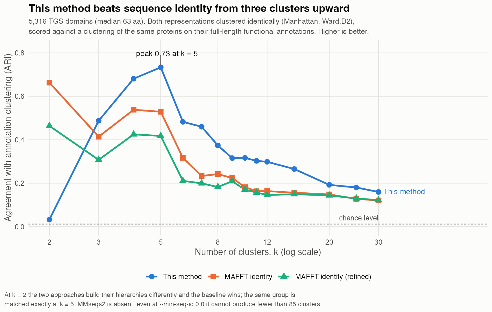
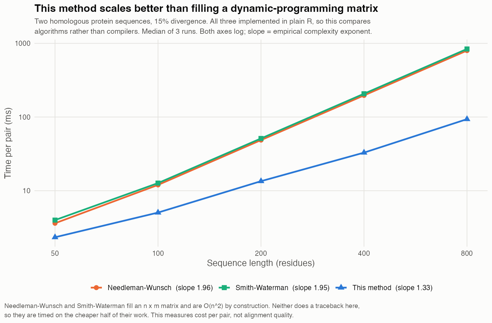

# Alignment-free protein clustering

An original method for grouping protein sequences that does not build a multiple sequence alignment.
Run on 5,316 TGS **domain** sequences (median 63 aa), the clusters it finds agree strongly with an
independent clustering of the same proteins by their **full-length** functional annotations
(**adjusted Rand index 0.73 at 5 clusters, p = 0.001** against 1,000 random relabelings). In other
words a ~63 aa domain, on its own, largely recovers the protein family its host protein belongs to.

> **Code and method availability.** Neither the source nor the method is described here. Both were
> developed at the University of Illinois Urbana-Champaign, where intellectual property created using
> University resources is subject to the University's rules, so neither is mine to publish. What
> follows is what the method achieves, how it was validated, and where it fails — all of which can be
> judged without knowing how it works. Details are available privately on request.

Against the standard alternative — a MAFFT alignment, pairwise identity, and the *same* downstream
clustering — this method agrees with the annotations better at every resolution from three clusters
upward. Iterative refinement of the alignment (MAFFT FFT-NS-i, 30 min of CPU) made the baseline
*worse*, not better, so the baseline shown is its stronger version:

## The problem it addresses

Clustering a protein family conventionally begins with a multiple sequence alignment. Over sequences
this divergent, that alignment is the weak link: MAFFT spread these 63 aa domains across 634 columns —
ten times their own length in gaps — and refining it made the downstream clustering worse. Much of the
positional correspondence such an alignment asserts is not supported by the sequences themselves.

This method takes a different route and never builds one.

## Runtime

Avoiding the n x m scoring matrix that Needleman-Wunsch and Smith-Waterman must fill changes how cost
grows with sequence length. Timed with all three implemented in plain R, so the comparison is of
algorithms rather than of compilers:

| Method | Fitted exponent | 50 aa | 800 aa |
|---|---|---|---|
| **This method** | **n^1.33** | 2.3 ms | **94 ms** |
| Needleman-Wunsch | n^1.96 | 3.6 ms | 797 ms |
| Smith-Waterman | n^1.95 | 4.0 ms | 838 ms |

Both dynamic-programming aligners land at the n^2 their construction implies, and neither is doing a
traceback here, so they are timed on the cheaper half of their work. The gap widens with length, which
is what matters when a method is applied pairwise across thousands of sequences.

## Results

| Test | Proteins | Agreement with annotation clustering |
|---|---|---|
| Full TGS-domain set, 5 clusters | 5,316 | ARI 0.734 (best of 1,000 shuffles: 0.007; p = 0.001) |
| Full TGS-domain set, 11 clusters | 5,316 | ARI 0.303 (best of 1,000 shuffles: 0.001; p = 0.001) |
| Example set (3 annotation groups, 20 proteins each) | 60 | ARI 0.902 (58 of 60 placed correctly), 11 s on a laptop |

At 5 clusters one cluster matches an annotation cluster exactly (1,082 of 1,082 proteins) and another
is 94% pure (2,003 of 2,138). Agreement falls at 11 clusters, where the two approaches divide closely
related subfamilies differently.

### What the reference clustering is

The annotations are the InterPro, Pfam, PANTHER, SUPFAM and PROSITE entries UniProt attaches to each
**whole protein** (76 distinct IDs, median 16 per protein) — not annotations of the TGS domain alone.
They include the TGS domain itself (PF02824, IPR004095) alongside the other domains of the host
protein: aminoacyl-tRNA synthetase catalytic domains (PF00587, IPR002314), and P-loop NTPase and
GTPase domains (IPR027417, IPR006073, PF01926).

So the comparison is asymmetric by construction, and that is the point of it. This method sees only
the ~63 aa domain; the reference groups proteins by their entire domain architecture. A high ARI means
the domain sequence alone carries the signal of the protein it came from. It does **not** mean two
methods clustered the same information two ways.

### How much the number depends on k

k, the number of clusters both trees are cut into, is a free choice, and ARI depends on it strongly:

| k | 2 | 3 | 4 | **5** | 6 | 7 | 8 | 9 | 11 | 15 | 20 | 30 |
|---|---|---|---|---|---|---|---|---|---|---|---|---|
| ARI | 0.03 | 0.49 | 0.68 | **0.73** | 0.48 | 0.46 | 0.37 | 0.32 | 0.30 | 0.27 | 0.19 | 0.16 |

**0.734 is the peak, not a typical value.** It sits at k = 5 and falls away on both sides; across
k = 2–12 the median is about 0.46. Quote it as "0.73 at 5 clusters", never as "ARI 0.73" unqualified.

Because k was chosen by looking at the result, a plain permutation null understates chance. A
selection-aware null — shuffle the labels, then take the best ARI over k = 2–12, exactly the selection
the observed value went through — gives a null mean of 0.002 and a maximum of 0.012 over 1,000
shuffles, against an observed 0.734. So **p = 0.001 holds even after accounting for the choice of k**.

ARI is already chance-corrected by construction (expected value 0 under random labelling); the
permutation nulls confirm that empirically rather than adding a second correction.

## Limitations

- Agreement with the annotation clustering is the only benchmark. Those annotations are themselves
  derived from sequence models, so this measures recovery of known families, not biological truth.
- Aggregated across k = 2–30 this method wins 14 of 15 comparisons, mean ARI 0.352 vs 0.281 (0.375 vs
  0.254 for k >= 3). But **each method at its own best k is much closer** — 0.734 at k = 5 against
  identity's 0.663 at k = 2, a gap of only +0.07. At matched resolution the advantage is large and
  consistent; as a best-case-vs-best-case claim it is modest. Quote whichever you mean.
- None of these differences has a confidence interval. Bootstrapping over proteins would require
  re-clustering 5,316 sequences per replicate, which was not run. Treat the direction as solid and the
  exact gap as unmeasured.
- Two MAFFT settings were tried: FFT-NS-2 (fast, 4 s) and FFT-NS-i (iterative refinement, 30 min).
  Refinement was consistently worse (0.418 vs 0.529 at k = 5), most likely because optimising a
  sum-of-pairs score over sequences this divergent forces spurious correspondences. The fast alignment
  is reported as the baseline because it is the stronger one.
- The baseline comparison covers one alternative representation through one clustering procedure.
  MMseqs2 could not be included at comparable resolution: even at `--min-seq-id 0.0`, coverage 0.3 and
  maximum sensitivity it bottoms out at **85 clusters**, because greedy clustering needs detectable
  pairwise similarity and many of these domains are too divergent. Where it does operate, at k = 85,
  all three are close and low (0.102, 0.085, 0.089).
- **At k = 2 the baseline wins decisively** (0.663 vs 0.032), because the two approaches build their
  hierarchies differently at the coarsest level. A real limitation if a two-way split is what you need.
- Only k was varied. The downstream clustering settings were held fixed for both methods.
- Agreement drops at finer resolution (ARI 0.30 at 11 clusters).
- The method depends on exact sequence correspondence, so very distant homologs sharing little
  identical sequence are harder to place.

## Data

| Path | Contents |
|---|---|
| `data/` | The 5,316 TGS domain sequences and the annotation matrix they are scored against |
| `results/` | The three figures and the per-cluster output |

## Author

Sam Belsky. Developed in the Jin Lab, University of Illinois Urbana-Champaign.
