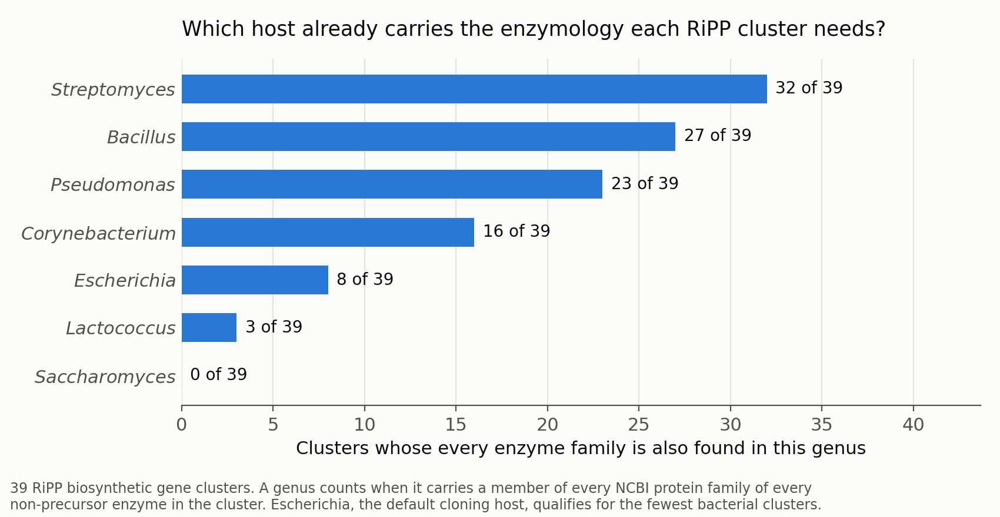

# Picking an expression host for a biosynthetic gene cluster

Heterologous expression fails often, and usually late: you clone a natural-product gene cluster into
a host, and some enzyme in it does not fold, does not get its cofactor, or has no substrate to work
on. This tool makes a cheap, up-front guess at which host is least likely to hit that wall, by asking
a question about protein families rather than about the sequences themselves:

> **Code availability.** The source for this project is not in this repository. It was written at the
> University of Illinois Urbana-Champaign, where intellectual property developed using University
> resources is subject to the University's rules, so it is not mine to publish. Everything below —
> the method, the measurements, the figures and the limitations — describes work that exists and
> runs; the code itself is available privately on request.

> For every enzyme in this cluster, does the candidate host's genus already contain a protein from
> the same family? If so, that lineage has the machinery, folding environment and precursors those
> enzymes evolved alongside.

Across 39 RiPP biosynthetic gene clusters, *Escherichia* — the default cloning host — qualified for
only 8, while *Streptomyces* qualified for 32. That ordering matches what RiPP labs find at the
bench, and the tool produces it before any cloning is done.

## How it works

1. **Read the cluster**: one row per gene (accession and annotated function). Precursor peptides are
   skipped; they carry no enzymology.
2. **Enzyme → protein families.** NCBI's Protein Family Models (Sparcle) rather than the conserved
   domain database, because Sparcle includes domains of unknown function — and RiPP biosynthesis is
   full of exotic enzymes whose domains are exactly that.
3. **Family → organisms.** Every protein that belongs to the family, and the genus (or species) each
   one comes from.
4. **Intersect**, twice: across the families of one enzyme, then across the enzymes of the cluster.
   What survives is the set of genera that carry the complete enzymology of the cluster.
5. **Intersect with your hosts**, the strains you can actually culture and transform.

## Results on 39 RiPP clusters

13 RiPP classes, from `data/RiPPs3.csv`. Hosts tested: *Escherichia*, *Streptomyces*, *Bacillus*,
*Lactococcus*, *Corynebacterium*, *Pseudomonas*, *Saccharomyces*.

| | Clusters |
|---|---|
| Analysed | 39 |
| At least one candidate genus found | 36 |
| At least one of the seven hosts qualified | 34 |
| At least one gene with no family data (result based on the rest) | 13 |

Candidate genera per cluster ranged from 0 to 407 (median 66), so the method discriminates: it is not
simply returning every well-sequenced organism. The three clusters with no candidate genus are a
useful answer too — they contain an enzyme family so narrowly distributed that no single lineage
carries the whole set, which is a warning that the cluster will be hard to express anywhere.

Beyond the seven hosts, the genera sharing the most clusters' enzymology were *Streptomyces* (32),
*Bacillus* and *Paenibacillus* (27), *Micromonospora* and *Nocardia* (24).

## What this is and is not

**It is not validated against expression outcomes.** No cluster here was expressed in these hosts and
scored for success. The agreement with what RiPP labs do in practice is encouraging but it is not
evidence. Doing it properly would need a set of published attempts with known outcomes, which is the
obvious next step and the thing a reviewer should ask for.

Other limits worth knowing:

- **Genus is coarse.** A genus carrying a family does not mean your strain carries it. `--rank species`
  is stricter but much sparser.
- **Family membership reflects what has been sequenced**, so well-studied lineages look better than
  they are.
- **Large families are sampled**, not exhausted: the first 2,000 members (`MEMBER_CAP`), which is
  enough to saturate the genus list in practice but is a cap, not a census.
- **Absent data is not absence.** 13 of 39 clusters had a gene with no family record; those clusters
  are scored on their remaining genes and flagged in the output.

## What the code does

| Component | Role |
|---|---|
| Host selector | For each enzyme in a cluster, resolves its NCBI protein families, finds the genera carrying every family, intersects across enzymes, then against candidate hosts |
| Figure | Draws the host comparison from the per-cluster output |
| 2023 originals | The rotation-era versions, which screen-scraped a page NCBI now renders in the browser |

## History

Written in 2023 during a rotation in a natural-products lab (`original/Original_Expression_Selection.py`),
where the motivating problem was watching RiPP clusters fail to express. `original/FaMESS.py` is a
later variant used to survey which genera recur across RiPP classes.

The original read protein families by scraping an NCBI web page. NCBI now builds that page in the
browser, so the scrape silently returned nothing and every cluster came back "no organisms found".
`select_hosts.py` is a 2026 rewrite: identical logic, but family lookups go through the E-utilities
API, large families are fetched in batches and cached, and the interactive prompts became command-line
options so it can run unattended.

## Author

Sam Belsky.
