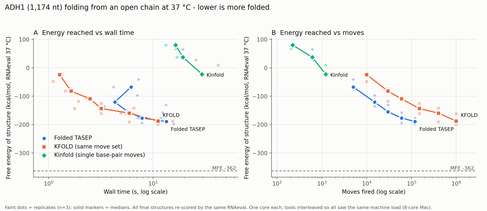
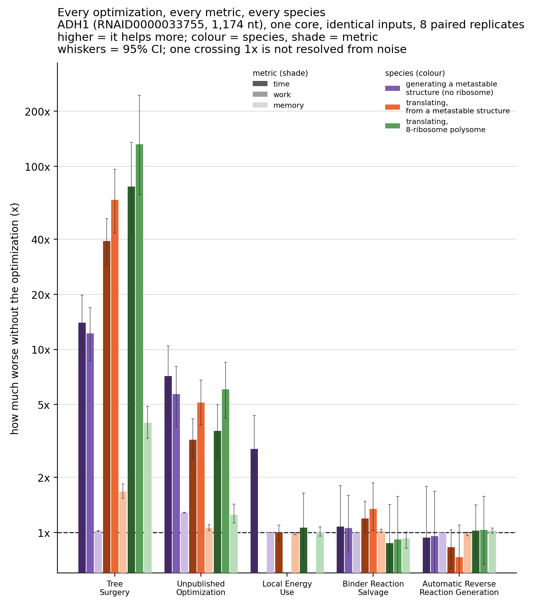

# Folded TASEP: ribosomes on an mRNA that keeps refolding

A stochastic (Gillespie) simulator of translation in which the mRNA's secondary structure is not
fixed: it folds and unfolds helix by helix while ribosomes, scanning 43S complexes and helicases bind,
move along it and pull it apart. Written in C++20 on top of the ViennaRNA energy model, built to ask how
mRNA structure shapes translation initiation and elongation in yeast.

> **Code availability.** The source for this project is not in this repository. It was written at the
> University of Illinois Urbana-Champaign, where intellectual property developed using University
> resources is subject to the University's rules, so it is not mine to publish. Everything below —
> the method, the measurements, the figures and the limitations — describes work that exists and
> runs; the code itself is available privately on request.

It folds RNA further per move than the published folding simulator KFOLD (which uses the same move set)
at a similar wall time, and far faster than Kinfold:

## What it models

- **RNA folding at the helix level.** Six structural moves (helix nucleation, extension, retraction,
  opening, morphing and defect diffusion) in the style of KFOLD (Dykeman 2015), with Kawasaki rates and
  ViennaRNA (Turner 2004) energies at a settable temperature (`--temp-k`).
- **Proteins acting on that structure.** 29 reactions (`src/reactions.csv`) covering eIF4F and Ded1
  helicase binding and ATP use, 43S pre-initiation complex loading and scanning, subunit joining, and
  ribosome elongation, with rates that depend on the local structure the complex has to unwind.
- **Exclusion.** Every bound complex occupies a footprint of nucleotides, so ribosomes queue and block
  each other as in a TASEP, and bases under a footprint cannot pair.

It runs standalone (`--standalone`) or as a reaction provider inside a larger whole-cell simulation
(`--framework`, API in `src/Folded_TASEP_Framework.hpp`).

The model was first prototyped in Python (`python_prototype/`, an unfinished draft); it was too slow for
realistic transcript lengths, so the design was ported to C++, where the optimizations below were built.

## Making it fast

Every event changes the structure only locally, but a naive simulator rebuilds every possible move on
the whole RNA afterwards. Two changes removed most of that cost:

- **Tree surgery** (after Dykeman 2016). The structure is kept as a graph of loops and helices, and an
  event edits only the parts it touches rather than rebuilding the graph. This is a published method;
  the contribution here is the implementation and its validation.
- **An unpublished optimization** (original to this project). Profiling showed that most of the
  per-event cost was work an event could not have invalidated. Avoiding it is worth **7.2x** on
  folding and 3.2-3.6x while translating. The method is withheld, but its correctness is not asserted
  on trust: an exact oracle rebuilt the entire structure graph and every folding move after each
  event and compared them, over 8.2 million energy evaluations with zero mismatches.

Measured on ADH1 (1,174 nt), one core, 8 paired replicates. Each bar is how many times slower the
simulator runs with that one optimization switched off, with everything else held at its shipped
setting. Whiskers are 95% confidence intervals; a bar whose interval crosses 1x is not resolved from
noise. Three workloads: folding with no ribosome, translating from a metastable structure, and an
eight-ribosome polysome.

Tree surgery and the unpublished optimization are the two that carry the simulator — 14x and 7.2x on folding,
rising to 78x and 3.6x on a polysome. Local energy evaluation helps only the folding-heavy workload,
and the remaining two are not resolved from noise on these metrics.

The **exact oracle** is `--check-surgery`: after every event it rebuilds the whole structure graph and
every folding move from scratch and stops on any difference, so the optimizations are checked for
identical results, not just similar statistics.

With everything on, ADH1 runs at 1.3 seconds of compute per simulated second while folding, and faster
than real time while translating (0.2) or carrying an 8-ribosome polysome (0.4) (medians of 8; opening
phase of the run, where folding is most expensive).

## Benchmark against published folding simulators

ADH1 (1,174 nt) folding from a fully open chain at 37 °C, no proteins. Each tool on one core, the three
run in turn within each replicate (n = 3) so they shared the same machine load, on an 8-core Mac.
Every final structure is re-scored with the same `RNAeval -T 37 -d2`, so the energies are directly
comparable. Medians:

| | Moves | Wall time | Energy reached (kcal/mol) |
|---|---|---|---|
| **Folded TASEP** | 30,000 | 5.8 s | −155 |
| **Folded TASEP** | 120,000 | 13.5 s | **−189** |
| KFOLD | 150,000 | 3.2 s | −143 |
| KFOLD | 1,000,000 | 11.2 s | **−188** |
| Kinfold | 1,217 | 29.4 s | −23 |

- **Per move**, Folded TASEP folds much further than KFOLD: KFOLD needs about **8× as many moves** to
  reach the same energy (1,000,000 vs 120,000 for −188).
- **Per second** the two are close: about 11 s vs 13.5 s to reach that energy.
- **Kinfold**, which moves one base pair at a time, reached −23 kcal/mol in 29 s; Folded TASEP passed
  −120 in about 4 s.

Limits of this comparison: one gene, three replicates, and only the opening phase of folding (no tool
gets past about half of the minimum free energy, −362, within these budgets). The tools also use different
energy tables (KFOLD: Turner 1999) and rate constants, so "more productive moves" may reflect the
nucleation rate choice as much as the implementation. Short runs vary a lot in wall time (the 5,000-move
runs took 4.2–7.3 s) because different trajectories do different amounts of folding work.

## What the code does

| Component | Role |
|---|---|
| Simulator (C++20, ~190 KB) | Gillespie loop coupling helix-level RNA folding to ribosome, 43S and helicase movement under exclusion |
| Tree surgery | Incremental update of the structure graph after each event (Dykeman 2016) |
| Unpublished optimization | The original optimization described above; mechanism withheld |
| Reaction loader | Parses the 29-reaction network and its rate expressions |
| Framework API | Exposes the model as a reaction provider for a whole-cell simulation |

## Author

Sam Belsky. Developed in the Luthey-Schulten Lab, University of Illinois Urbana-Champaign.
